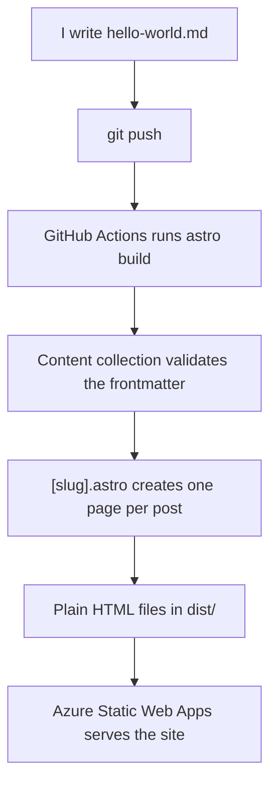
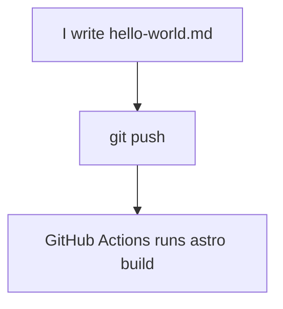

I wanted a blog where I could write posts as plain Markdown files, push them to GitHub, and see them live on my own domain a couple of minutes later. No CMS, no database, no monthly hosting bill.

So I built one with [Astro](https://astro.build), from an empty folder to a deployed site. This post walks through every step, including the mistakes I made along the way. If you know Razor Pages, you'll find a lot of it familiar.

By the end you'll have:

- Markdown files that become web pages automatically
- A home page listing every post, newest first
- A shared layout, dark mode, RSS and a sitemap
- The whole thing deployed for free on Azure Static Web Apps

The complete source code is on GitHub at [github.com/ishnetcode/blog](https://github.com/ishnetcode/blog), so you can follow along or compare your code with mine at any step.

## What is Astro, and why use it for a blog?

Astro is a **static site generator**. Instead of rendering HTML on every request like Razor Pages does, it renders everything **once, at build time**, and outputs plain `.html` files. Hosting those files is free and fast, because there's no server code running.

For a blog, that's ideal: the content only changes when I publish something new.

Here's the whole journey of a post, from Markdown file to live page:



The rest of this post builds each piece of that pipeline.

## Step 1: Create the project

You need Node.js first. My first attempt failed straight away:

```text
Node.js v22.13.1 is not supported by Astro!
Please upgrade Node.js to a supported version: ">=22.22.0"
```

Installing the current LTS version of Node from nodejs.org fixed it. Then, inside an empty repo cloned from GitHub:

```bash
npm create astro@latest .
```

I picked the **minimal (empty)** template rather than the ready-made blog template. The blog template works out of the box, but I wanted to understand every file, not read someone else's.

```bash
npm run dev
```

Open http://localhost:4321 and you've got a page.

**How routing works:** any file in `src/pages` becomes a URL. `src/pages/about.astro` becomes `/about`. If you know Razor Pages, this will feel natural.

*Docs: [Install Astro](https://docs.astro.build/en/install-and-setup/) · [Routing](https://docs.astro.build/en/guides/routing/)*

## Step 2: A shared layout

Every page needs the same header and footer. In Astro, that's a **layout**, the equivalent of `_Layout.cshtml`.

`src/layouts/BaseLayout.astro`:

```astro
---
import '../styles/global.css';
const { title } = Astro.props;
---

<html lang="en-GB">
  <head>
    <meta charset="utf-8" />
    <meta name="viewport" content="width=device-width" />
    <title>{title}</title>
  </head>
  <body>
    <header>
      <a href="/">Ish Rastogi</a>
      <nav>
        <a href="/">Home</a>
        <a href="/about">About</a>
      </nav>
    </header>

    <main>
      <slot />
    </main>

    <footer>
      <p>© {new Date().getFullYear()} Ish Rastogi</p>
    </footer>
  </body>
</html>
```

Two things to notice:

- The block between the `---` fences is JavaScript that runs **at build time**. `Astro.props` is how a page passes data in, a bit like a Razor model.
- `<slot />` is where the page's content goes, just like `@RenderBody()`.

My first version left out the `---` fences, and Astro happily printed `const { title } = Astro.props;` onto the page as text. The fences matter.

Using the layout in a page:

```astro
---
import BaseLayout from '../layouts/BaseLayout.astro';
---

<BaseLayout title="Ish Rastogi">
  <h1>Hello, I'm Ish</h1>
</BaseLayout>
```

*Docs: [Layouts](https://docs.astro.build/en/basics/layouts/)*

## Step 3: Define your posts with a content collection

This is the core idea. A **content collection** tells Astro: "these Markdown files are blog posts, and here's what each one must contain."

Create `src/content.config.ts`:

```ts
import { defineCollection } from 'astro:content';
import { z } from 'astro/zod';
import { glob } from 'astro/loaders';

const blog = defineCollection({
  loader: glob({ pattern: '**/*.md', base: './src/content/blog' }),
  schema: z.object({
    title: z.string(),
    description: z.string(),
    pubDate: z.coerce.date(),
    draft: z.boolean().default(false),
  }),
});

export const collections = { blog };
```

- The `glob` loader finds every `.md` file in `src/content/blog`.
- The `schema` uses Zod to validate each post's frontmatter. Think of it as a model class with validation attributes.
- `z.coerce.date()` turns the date text into a real `Date`, so you can sort and format it later.
- **Don't forget the `export` on the last line.** Without it, Astro doesn't know the collection exists.

Now write a post at `src/content/blog/hello-world.md`:

```markdown
---
title: "Hello world"
description: "My first post, testing the blog setup."
pubDate: 2026-10-17
draft: false
---

This is my first post. More soon.
```

The part between the `---` lines is **frontmatter**: data about the post. Everything below it is the post itself.

### The schema catches mistakes

This is my favourite part. When I got the frontmatter wrong, the build stopped with a clear error, just like a compile error:

```text
description: Required
pubDate: Expected type "date", received "object"
```

A missing field or a badly formatted date never makes it to the live site. Try deleting the `title` line and running `npm run build` to see it for yourself.

*Docs: [Content collections](https://docs.astro.build/en/guides/content-collections/)*

## Step 4: One page per post with dynamic routing

Now the bit that actually turns Markdown into web pages. Create a file literally named `[slug].astro` inside `src/pages/blog/`:

```astro
---
import { getCollection, render } from 'astro:content';
import BaseLayout from '../../layouts/BaseLayout.astro';

export async function getStaticPaths() {
  const posts = await getCollection('blog', (post) => !post.data.draft);

  return posts.map((post) => ({
    params: { slug: post.id },
    props: { post },
  }));
}

const { post } = Astro.props;
const { Content } = await render(post);
---

<BaseLayout title={post.data.title}>
  <article>
    <h1>{post.data.title}</h1>
    <p>{post.data.pubDate.toLocaleDateString('en-GB')}</p>
    <Content />
  </article>
</BaseLayout>
```

How it works:

- The square brackets make `slug` a route parameter, like `{slug}` in an ASP.NET route template.
- Because Astro builds everything ahead of time, it needs the full list of pages up front. That's what `getStaticPaths()` returns: one entry per post.
- `post.id` is the filename without `.md`, so `hello-world.md` becomes `/blog/hello-world`.
- `render(post)` converts the Markdown body into HTML, which `<Content />` outputs.
- The filter `(post) => !post.data.draft` skips drafts, much like LINQ's `.Where(p => !p.Draft)`.

When I first opened `/blog/hello-world`, I got a **404**. Restarting the dev server fixed it. Astro doesn't always pick up a new content config while it's running.

Add a second `.md` file and it gets its own page without writing any more code. That's the whole point.

*Docs: [Dynamic routes](https://docs.astro.build/en/guides/routing/) · [getStaticPaths() reference](https://docs.astro.build/en/reference/routing-reference/)*

## Step 5: List the posts on the home page

`src/pages/index.astro`:

```astro
---
import BaseLayout from '../layouts/BaseLayout.astro';
import { getCollection } from 'astro:content';

const posts = (await getCollection('blog', (post) => !post.data.draft))
  .sort((a, b) => b.data.pubDate.valueOf() - a.data.pubDate.valueOf());
---

<BaseLayout title="Ish Rastogi">
  <h1>Hello, I'm Ish</h1>

  <ul class="posts">
    {posts.map((post) => (
      <li>
        <a href={`/blog/${post.id}`}>{post.data.title}</a>
        <p>{post.data.description}</p>
      </li>
    ))}
  </ul>
</BaseLayout>
```

You loop in the HTML with `.map()` inside curly braces, similar to a `@foreach` in Razor. The sort puts the newest post first.

I briefly got a `data is not defined` error here, from writing the filter as `getCollection('blog', !data.draft)`. It needs to be a function: `(post) => !post.data.draft`.

## Step 6: Styling and dark mode

One global stylesheet, imported in the layout. The trick that makes dark mode easy is **CSS variables**:

```css
:root {
  --bg: #fbfaf7;
  --text: #1d1f23;
  --accent: #0f6b5c;
}

@media (prefers-color-scheme: dark) {
  :root {
    --bg: #14161a;
    --text: #e6e4df;
    --accent: #5cc8b2;
  }
}

body {
  background: var(--bg);
  color: var(--text);
}
```

You define each colour once and use it everywhere. When the visitor's system is in dark mode, only the variable values change, with no JavaScript needed.

One lesson I learned: I first styled every `li` on the site to remove bullet points, which would also have removed them from lists inside my posts. Giving the post list a class (`.posts li`) keeps styles where you intend them.

*Docs: [Styles and CSS](https://docs.astro.build/en/guides/styling/)*

## Step 7: RSS and a sitemap

These take about ten minutes and are worth it.

- **RSS** lets people follow the blog in a feed reader.
- **A sitemap** tells search engines about every page.

First, set your site URL in `astro.config.mjs`:

```js
export default defineConfig({
  site: 'https://blog.ishrastogi.in',
});
```

Then add the sitemap with one command:

```bash
npx astro add sitemap
```

For RSS, install `@astrojs/rss` and create `src/pages/rss.xml.js`. A file that returns data instead of HTML is called an **endpoint**, a bit like a Web API controller action:

```js
import rss from '@astrojs/rss';
import { getCollection } from 'astro:content';

export async function GET(context) {
  const posts = await getCollection('blog', (post) => !post.data.draft);

  return rss({
    title: 'Ish Rastogi',
    description: 'Notes on .NET, cloud and building production AI systems.',
    site: context.site,
    items: posts.map((post) => ({
      title: post.data.title,
      description: post.data.description,
      pubDate: post.data.pubDate,
      link: `/blog/${post.id}/`,
    })),
  });
}
```

*Docs: [Add an RSS feed](https://docs.astro.build/en/guides/rss/) · [@astrojs/sitemap](https://docs.astro.build/en/guides/integrations-guide/sitemap/) · [Endpoints](https://docs.astro.build/en/guides/endpoints/)*

## Step 8: Deploy for free on Azure Static Web Apps

1. Push the project to GitHub.
2. In the Azure portal, create a **Static Web App** on the **Free** plan and connect it to the repo.
3. Astro wasn't in the build presets list, so I chose **Custom** with app location `/` and output location `dist`.

Azure adds a GitHub Actions workflow to the repo, and from then on **every push to `main` deploys automatically**. Remember to `git pull` afterwards, because Azure commits that workflow file for you.

For the custom domain, I added a **CNAME** record for `blog` at my domain registrar pointing to the Azure address, then validated it in the portal. For the first few minutes the browser showed "Not secure", because Azure hadn't issued the SSL certificate yet. It sorted itself out shortly after.

*Docs: [Deploy your Astro site to Microsoft Azure](https://docs.astro.build/en/guides/deploy/microsoft-azure/)*

## Bonus: diagrams as code with Mermaid

The diagram near the top of this post isn't an image. It's a few lines of text in my Markdown file:

````markdown

````

Astro doesn't draw [Mermaid](https://mermaid.js.org/) diagrams on its own, but it only takes two small changes.

First, tell Astro's syntax highlighter to leave Mermaid blocks alone, in `astro.config.mjs`:

```js
export default defineConfig({
  markdown: {
    syntaxHighlight: {
      type: 'shiki',
      excludeLangs: ['mermaid'],
    },
  },
});
```

Then install Mermaid with `npm install mermaid`, and add a script to the bottom of `[slug].astro` that turns those blocks into diagrams in the browser:

```astro
<script>
  async function renderDiagrams() {
    const blocks = document.querySelectorAll('pre > code.language-mermaid');
    if (blocks.length === 0) return;

    const { default: mermaid } = await import('mermaid');

    blocks.forEach((code) => {
      const diagram = document.createElement('div');
      diagram.className = 'mermaid';
      diagram.textContent = code.textContent;
      code.parentElement.replaceWith(diagram);
    });

    const dark = window.matchMedia('(prefers-color-scheme: dark)').matches;
    mermaid.initialize({ startOnLoad: false, theme: dark ? 'dark' : 'default' });
    await mermaid.run();
  }

  renderDiagrams();
</script>
```

The `import('mermaid')` inside the function is a **dynamic import**, so Mermaid's JavaScript only downloads on posts that actually contain a diagram. Every other page stays free of JavaScript.

My first attempt used the `rehype-mermaid` plugin, which failed with `Cannot find package 'playwright'`. It needs a headless browser to work, which is more than a blog needs. Astro's built-in `excludeLangs` option plus this script turned out to be simpler.

*Docs: [Syntax highlighting](https://docs.astro.build/en/guides/syntax-highlighting/) · [Mermaid](https://mermaid.js.org/)*

## What I'd tell myself before starting

- **Start with the minimal template.** You'll understand every file in your project.
- **Restart the dev server** when something "should" work but doesn't.
- **Let the schema work for you.** Validation errors at build time are much better than broken pages in production.
- **Ship early.** I deployed a "Hello world" page before writing any real features, so every step after that was visible on my own domain.

The whole build took me an evening and a morning, and publishing a post is now just writing a Markdown file and running `git push`.

You're reading the result. Browse the full source code at [github.com/ishnetcode/blog](https://github.com/ishnetcode/blog).

## Further reading

All from the official Astro documentation:

- [Install Astro](https://docs.astro.build/en/install-and-setup/): prerequisites and creating a project
- [Routing](https://docs.astro.build/en/guides/routing/): file-based and dynamic routes
- [Layouts](https://docs.astro.build/en/basics/layouts/): shared page structure
- [Content collections](https://docs.astro.build/en/guides/content-collections/): loaders, schemas and querying posts
- [Routing reference](https://docs.astro.build/en/reference/routing-reference/): `getStaticPaths()` in detail
- [Styles and CSS](https://docs.astro.build/en/guides/styling/): global and scoped styles
- [Endpoints](https://docs.astro.build/en/guides/endpoints/): pages that return data instead of HTML
- [Add an RSS feed](https://docs.astro.build/en/guides/rss/)
- [@astrojs/sitemap](https://docs.astro.build/en/guides/integrations-guide/sitemap/)
- [Deploy to Microsoft Azure](https://docs.astro.build/en/guides/deploy/microsoft-azure/)
- [Syntax highlighting](https://docs.astro.build/en/guides/syntax-highlighting/): including `excludeLangs` for diagram tools
